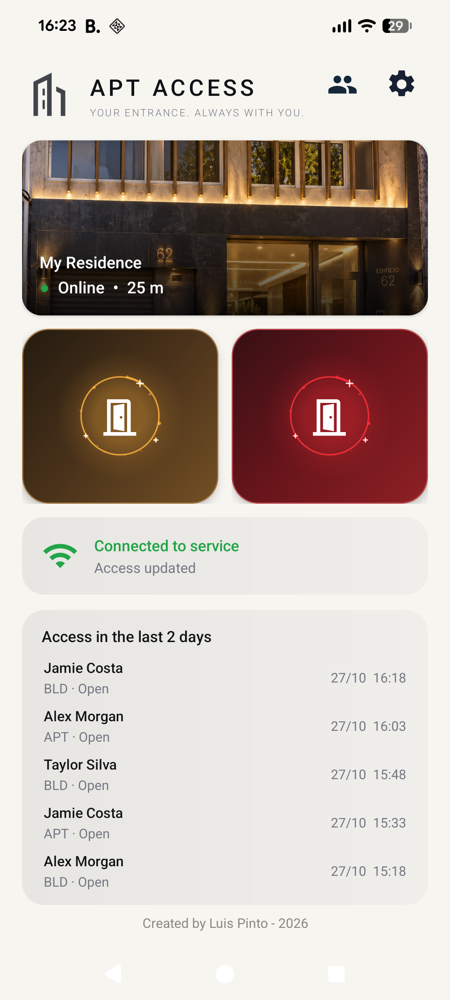
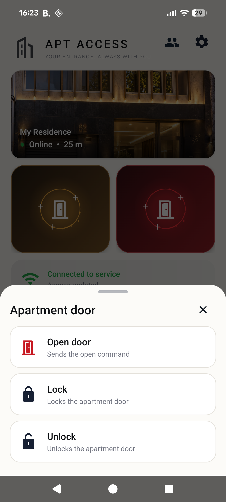
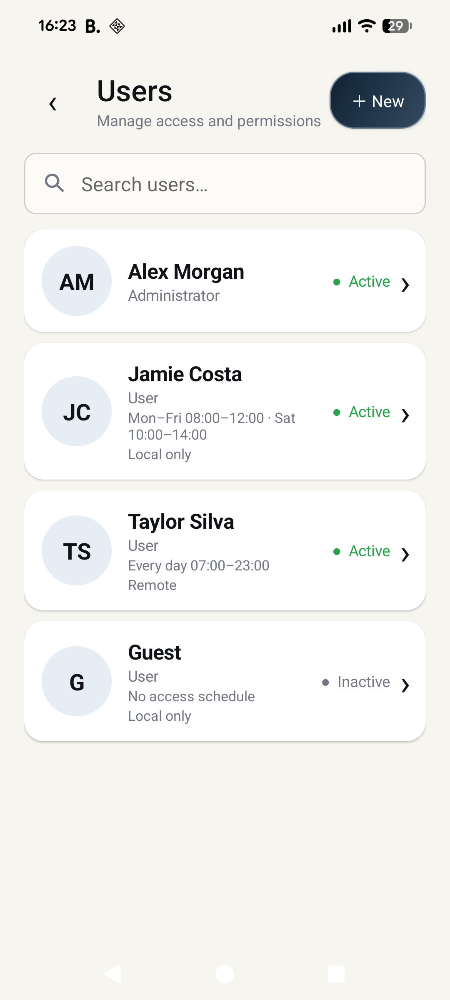
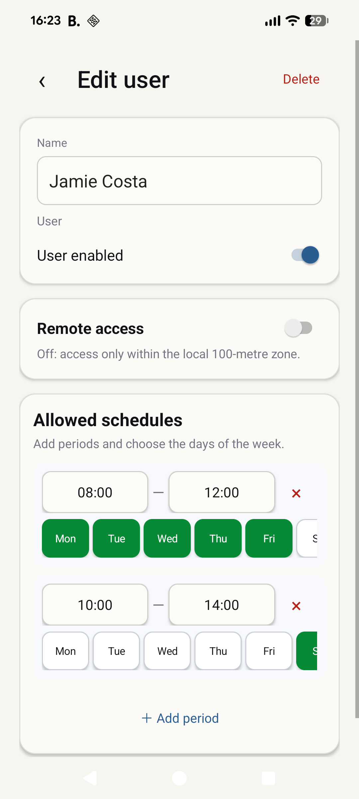
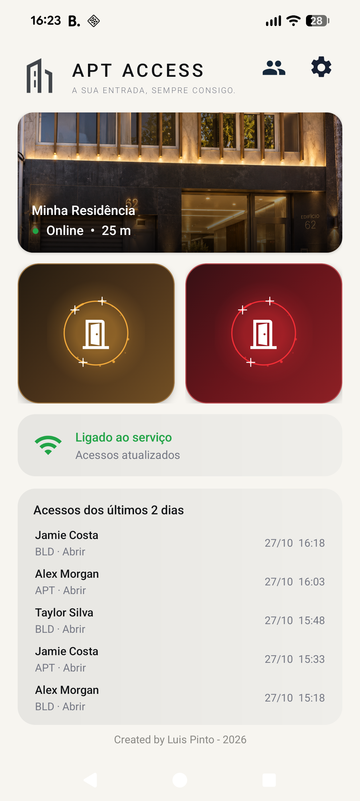
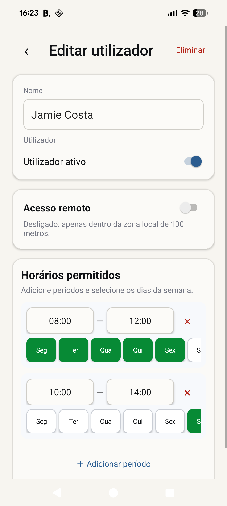

<h1 align="center">APT Access</h1>

<p align="center">
  <strong>Apartment and building access, from your Android phone.</strong><br>
  Open doors, manage permissions, and set access schedules through your own compatible server.
</p>

<p align="center">
  <a href="#screenshots">Screenshots</a> ·
  <a href="#features">Features</a> ·
  <a href="#getting-started">Getting started</a> ·
  <a href="#build-from-source">Build</a> ·
  <a href="#security-and-privacy">Security</a>
</p>

---

APT Access is a native Android client with English and European Portuguese interfaces, biometric confirmation for door operations, and administrator tools for managing who can enter and when.

**Bring your own backend.** No server is configured by default. You need a compatible access-control API and a bearer token issued by its administrator. This repository contains the Android app; the server and door hardware are separate.

## Screenshots

Actual app screens captured on a Google Pixel 8a. The Preview build uses fictional users and a local demonstration API; no personal server address or credentials appear in these images.

<table>
  <tr>
    <td align="center"><strong>Door controls &amp; recent access</strong></td>
    <td align="center"><strong>Apartment actions</strong></td>
  </tr>
  <tr>
    <td></td>
    <td></td>
  </tr>
  <tr>
    <td align="center"><strong>User administration</strong></td>
    <td align="center"><strong>Weekly schedules</strong></td>
  </tr>
  <tr>
    <td></td>
    <td></td>
  </tr>
</table>

<details>
<summary><strong>Português de Portugal</strong></summary>

<p align="center">
  
  
</p>

</details>

## Features

| | What you can do |
| :--- | :--- |
| **Door controls** | Open the building entrance; open, lock, and unlock the apartment door. |
| **Device authentication** | Confirm each door operation with a strong biometric, such as a fingerprint, or the device PIN, pattern, or password. |
| **Location-aware access** | Send location with requests and display access capabilities returned by the server. Local access uses a fixed 100 m zone; remote access has no distance limit. |
| **User administration** | Administrators can search, create, edit, enable, disable, and delete users. |
| **Weekly schedules** | Add multiple access periods and choose the permitted days of the week. |
| **Recent activity** | Administrators can view access history for the last two days, with up to five visible rows and scrolling within the list. |
| **Protected credentials** | Store the bearer token encrypted with AES-GCM using a key held in Android Keystore. |

## Downloads

Get the APKs from [GitHub Releases](https://github.com/xsoulp/domotica_androidapp/releases):

| APK | Authentication |
| :--- | :--- |
| [**Fingerprint APK**](https://github.com/xsoulp/domotica_androidapp/releases/download/v1.5/APT-Access-1.5-fingerprint.apk) | Strong biometric authentication with device PIN, pattern, or password as a fallback. |
| [**PIN APK**](https://github.com/xsoulp/domotica_androidapp/releases/download/v1.5/APT-Access-1.5-pin.apk) | Device PIN, pattern, or password, without prompting for a fingerprint. |

Both variants require Android 11+ and a configured screen lock. The published APKs use the same app ID and signing key, so installing one replaces the other while keeping settings. The APKs use debug signing and are sideload builds. Release APKs retain the project's existing signing identity, so updates preserve saved settings. Independently built APKs may use a different signing key.

## Getting started

You will need:

- **Android 11 or newer** (API 30+), with a PIN, pattern, or password configured. Enrol a fingerprint or another strong biometric to use biometric confirmation.
- A **compatible backend** connected to your door hardware, its base URL, and a bearer token.
- Network connectivity and permission to use **precise location**.

After [building the app](#build-from-source), enable USB debugging, connect your phone, and install it:

```bash
adb install -r app/build/outputs/apk/debug/app-debug.apk
```

1. Open the app and go to **Settings** (**Definições** on Portuguese phones).
2. Enter your server's base URL and the bearer token supplied by your administrator. Use HTTPS for deployed servers.
3. Save, allow precise location when prompted, and return to the home screen.
4. Choose a door action and confirm with your fingerprint or device screen lock.

The app identifies the user from the token. Administrator controls appear for users with the appropriate server permissions. The server field starts empty; the app does not contact a default deployment.

## Build from source

| Component | Version |
| :--- | :--- |
| Java | 17 |
| Android SDK | 36 (compile and target) |
| Minimum Android | 11 / API 30 |
| Android Gradle Plugin | 9.4.0 |
| Gradle wrapper | 9.6.0 |
| App | 1.5 |

Install the Android SDK and configure its location using `ANDROID_HOME` or an untracked `local.properties` file with `sdk.dir` pointing to your SDK directory. Then run:

```bash
./gradlew assembleDebug assemblePin lintDebug lintPin
```

Build outputs:

- Fingerprint: `app/build/outputs/apk/debug/app-debug.apk`
- PIN: `app/build/outputs/apk/pin/app-pin.apk`

On Windows, use `gradlew.bat`.

<details>
<summary><strong>Google Pixel 8a build variant</strong></summary>

The project also includes a debug-derived Pixel 8a variant with biometric authentication enabled. Device PIN, pattern, or password remains available as a fallback.

```bash
./gradlew assemblePixel8a
adb install -r app/build/outputs/apk/pixel8a/app-pixel8a.apk
```

The standard debug build also enables biometric authentication.

For isolated UI testing, `./gradlew assemblePreview` produces an **APT Access Preview** app with a separate application ID and separate saved settings. It does not share credentials with the installed app.

</details>

## Backend integration

The app follows the phone’s language: Portuguese uses European Portuguese; other languages use English. Android 13+ also offers a per-app language setting.

See the [backend API guide](docs/BACKEND.md) for server requirements, authentication, door commands, user management, schedules, and JSON examples.

## Security and privacy

- **Server choice is explicit.** The source includes no default server address. Server settings and credentials are entered on the device.
- **Use HTTPS.** The app currently permits HTTP for local deployments; transport encryption depends on the URL you configure.
- **Tokens are encrypted at rest.** The bearer token is encrypted with AES-256-GCM and a key in Android Keystore. Android application backups are disabled.
- **Door actions require device authentication.** Access rules, schedules, and administrator privileges must also be enforced by the backend.
- **Location is shared with your server.** Client-reported GPS coordinates can be spoofed. Device authentication does not make them cryptographic proof of physical presence.

Created by **Luis Pinto** · 2026

## Project layout

```text
app/src/main/
├── java/pt/xsoulp/domotica/   Activities, API client, and credential storage
├── res/layout/              Native Android screen layouts
├── res/drawable/            Icons, backgrounds, and visual components
└── AndroidManifest.xml      App configuration and permissions
docs/images/                 Actual app screenshots
docs/BACKEND.md              Backend requirements and API contract
.github/workflows/           Build checks and downloadable APK artifacts
```
