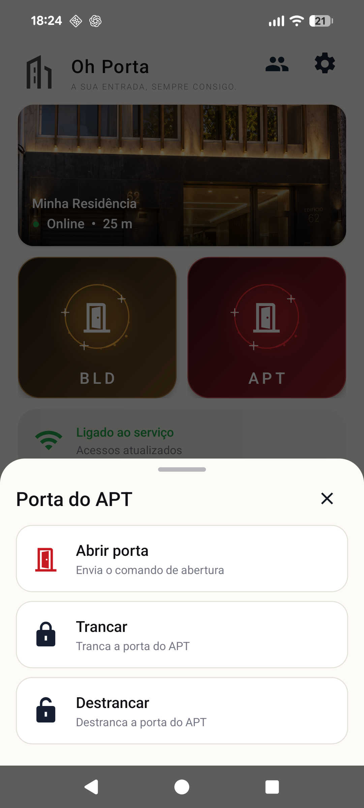
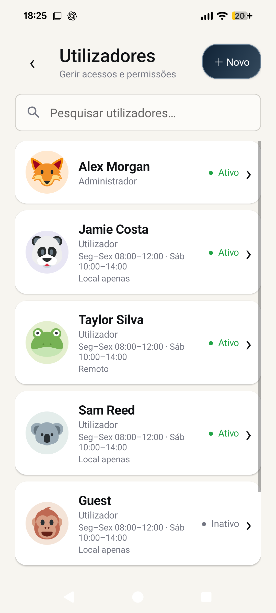

# Portuguese interface screenshots

Actual OhPorta screens captured on a Google Pixel 8a, using fictional accounts in the isolated Preview app. The root [README](../README.md) shows the English interface.

| Home and recent access | Apartment actions |
| :---: | :---: |
|  |  |

| Users and animal avatars | Weekly schedules |
| :---: | :---: |
|  |  |
